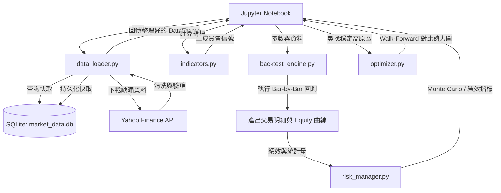

# 交易績效追蹤系統設計規格書 (Trading Performance Tracking System Design)

本文件定義了 SuperTrend 指標交易績效追蹤系統的架構、資料庫持久化、介面契約、交易事件優先序、資料流與驗證方法。本系統旨在幫助使用者以正體中文的介面，回測 SuperTrend 策略、進行 Walk-Forward 樣本外優化，並利用 SQLite 進行資料本地化管理與 Monte Carlo 風險評估。

---

## 1. 系統架構與目錄結構

為了確保系統的模組化、高可測試性與互動性，本專案採用 **Modular Package 結構 + Jupyter Notebook 前端**。

### 目錄結構
```
SuperTrend/
├── data/                          # 本地 SQLite 資料庫存放目錄
│   └── market_data.db             # 市場歷史價格資料庫
├── spec/                          # 需求與設計導引文件 (設計原稿)
├── src/                           # 核心邏輯模組
│   ├── __init__.py
│   ├── storage.py                 # SQLite 本地資料庫儲存層 [NEW]
│   ├── data_loader.py             # 資料下載與儲存協調器 (yfinance)
│   ├── indicators.py              # 指標計算核心 (SuperTrend, HMA, EMA, SMA, ADX, RSI)
│   ├── backtest_engine.py         # 交易回測引擎 (支援交易成本、Gap、Sizing、多時間對齊)
│   ├── risk_manager.py            # 績效指標計算與 Monte Carlo 模擬
│   └── optimizer.py               # 參數網格與 Walk-Forward 優化器
├── tests/                         # 自動化單元測試
│   ├── __init__.py
│   ├── test_storage.py            # 測試 SQLite 讀寫與 Upsert 邏輯 [NEW]
│   ├── test_data_loader.py
│   ├── test_indicators.py
│   ├── test_backtester.py
│   └── test_risk.py
├── SuperTrend_Backtester.ipynb    # 使用者互動式操作與 Plotly 圖表展示 Notebook
├── requirements.txt               # 套件依賴項
├── README.md                      # 正體中文使用說明文件
└── TechStack.html                 # 正體中文技術架構與架構決策說明
```

---

## 2. 模組設計與職責

### A. Local Storage Layer (`src/storage.py`) [NEW]
* 負責建立 `data/market_data.db` 資料庫與初始化表格。
* 主要資料表：`price_history`，用於快取歷史 K 線，欄位定義如下：
  * `ticker` (TEXT, PK): 標的代碼（例如 `SPY`）。
  * `interval` (TEXT, PK): 時間週期（例如 `1d`, `1h`）。
  * `datetime` (TEXT, PK): ISO 格式時間戳記（時區統一轉為 UTC Naive 以便比對）。
  * `open` (REAL), `high` (REAL), `low` (REAL), `close` (REAL): 價格資料。
  * `volume` (REAL): 成交量。
  * `source` (TEXT): 來源標記，預設為 `'yfinance'`。
  * `adjusted` (INTEGER): 是否已做除權息調整（1 為 True, 0 為 False）。
  * `created_at` (TEXT), `updated_at` (TEXT): 系統寫入戳記。
* 提供 `upsert_prices(df, ticker, interval)` 寫入邏輯，若主鍵衝突則更新，避免重複資料。

### B. Data Loader (`src/data_loader.py`)
* 作為資料快取協調器。當外部呼叫 `fetch_data(ticker, start, end, interval)` 時：
  1. 優先至 `SQLiteStorage` 查詢該區間資料。
  2. 若本地資料已完整覆蓋，直接轉回 pandas DataFrame。
  3. 若資料不完整，向 yfinance 抓取缺漏日期區間。
  4. 經資料驗證後，呼叫 `upsert_prices()` 存入 SQLite，再回傳完整區間。
* 預設開啟 `auto_adjust=True` 確保下載除權息調整後的歷史價格。

### C. Indicators Manager (`src/indicators.py`)
* 計算技術指標的核心函式，維持純粹的 pandas/numpy 計算，便於單獨測試：
  * **SuperTrend:** 基於 ATR 的波動率通道趨勢跟蹤指標。
  * **Moving Averages:** 支援 SMA, EMA 與 Hull Moving Average (HMA)。
  * **ADX / RSI:** 分別作為趨勢強度（避免盤整被洗）與動能進場過濾器。

### D. Backtest Engine (`src/backtest_engine.py`)
* 採用 iterative bar-by-bar（逐根 K 線）迴圈，精確模擬交易：
  * **交易成本模型:** 扣除 `commission_bps` 與 `slippage_bps` 摩擦。
  * **部位控管 (Position Sizing):** 支援固定比例 (Fixed Fraction) 或固定風險金額比例 (Fixed Risk)。
  * **時間對齊:** 支援 Single-Timeframe（以 Daily 收盤或 High/Low 判定）與 Multi-Timeframe（用 Daily 計算大趨勢並 Shift 1 天防 look-ahead，對齊至 1-Hour K 線進出場）。

### E. Risk Manager (`src/risk_manager.py`)
* 計算 CAGR, Max Drawdown, Sharpe, Sortino, Profit Factor, Calmar, Expectancy（交易期望值）與 Ulcer Index（潰瘍指數）。
* 執行 Monte Carlo 模擬，支援 `seed` 亂數重現，產出分位數最大回撤與終值報告。

### F. Optimizer (`src/optimizer.py`)
* 實作參數網格搜尋。
* 支援 **Walk-Forward Validation**，可分割樣本內 (Train) 與樣本外 (Test)，藉此評估參數在未見數據下的適應性。
* 輸出 `Score = 0.35 * Sharpe + 0.25 * Calmar + 0.20 * PF - 0.20 * abs(MaxDD)` 的排行高原。

---

## 3. 系統資料流與介面契約

### 系統資料邏輯流向


### 介面資料格式契約 (I/O Contracts)
1. **價格 DataFrame 格式 (DataLoader 輸出 / Indicators 輸入):**
   * **Index:** `pd.DatetimeIndex` (時區統一為 naive 避免混淆，遞增無重複)。
   * **必要欄位:** `Open`, `High`, `Low`, `Close`, `Volume` (均為 float64，無缺失值)。
2. **Trade Dataclass 結構 (BacktestEngine 輸出):**
   * `entry_date` (pd.Timestamp): 進場時間。
   * `entry_price` (float): 實際進場價格 (已加計買入滑價與成本)。
   * `exit_date` (pd.Timestamp): 出場時間。
   * `exit_price` (float): 實際出場價格 (已扣除賣出滑價與成本)。
   * `direction` (str): `'Long'` 或 `'Short'`。
   * `pnl_pct` (float): 單筆平倉報酬率 (例如 `0.05` 代表 5%)。
   * `exit_reason` (str): 出場原因 (`'Signal'`, `'StopLoss'`, `'TakeProfit'`)。
3. **RiskManager.calculate_metrics() 輸出契約:**
   * 回傳 `Dict[str, float]`，固定鍵值包含：`CAGR`, `Max Drawdown`, `Ulcer Index`, `Sharpe Ratio`, `Sortino Ratio`, `Win Rate`, `Profit Factor`, `Calmar Ratio`, `Expectancy`, `Avg Holding Days`, `Annual Trades`, `Max Consecutive Wins`, `Max Consecutive Losses`。

### 資料清洗與驗證規格 (Data Validation)
* **資料完整性檢查:** 執行回測前，剔除 `Close` 欄位為 Null 或價格小於等於 0 的不合法列。
* **價格一致性檢查:** 對每一筆 Bar 進行防錯校驗，必須滿足 `High >= max(Open, Close)` 且 `Low <= min(Open, Close)`，否則將自動修正為該 Bar 的最大/最小值並記錄日誌。
* **資料連續性:** 檢查日期索引是否嚴格單調遞增，若有重複時間戳記，僅保留第一筆。

---

## 4. 交易事件優先順序與成交假設

為了保證回測的嚴謹性，防止樂觀偏差，回測引擎採用以下事件優先序與跳空交易規則：

### A. 止損 (SL) 與止利 (TP) 在同一根 Bar 同時觸發時的處理
1. **在單一時間週期模式 (Daily) 下:**
   由於日線 K 棒只有高低價，無法得知日內先觸及何者。系統將**保守假設止損 (SL) 先發生**，直接結算止損出場。
2. **在多時間週期模式 (Daily + Hourly) 下:**
   系統會比對該交易日內的 1-Hour 細分 K 棒，依據 1-Hour K 棒的先後順序來判定是 High (TP) 還是 Low (SL) 先發生，從而獲得精確的成交紀錄。

### B. 事件處理優先順序 (Event Priority)
在處理每根 K 棒時，回測引擎依循以下固定優先順序判斷：
1. **開盤跳空檢驗 (Gap SL/TP):** 優先檢查開盤價 `Open` 是否已跌破 Stop-Loss 或突破 Take-Profit。若已穿過，則**以當日開盤價 `Open` 成交**。
2. **日內止損/止利檢驗 (Intraday SL/TP):** 檢查 High/Low 是否觸發止損/止利。
3. **收盤訊號檢驗 (Signal Exits):** 於收盤時檢查 SuperTrend 或其他指標是否發生翻轉訊號，若有則在收盤價（或次日開盤價，視設定而定）成交。

---

## 5. 視覺化圖表與報表呈現 (Visualizations & Reports)

Jupyter Notebook 將採用 Plotly 互動式圖表展示回測結果：
* **Equity Curve:** 疊加策略淨值曲線與 Buy & Hold 基準線，對比 Alpha 收益。
* **Drawdown Path:** 繪製策略與 Buy & Hold 的拉回幅度和恢復期長度。
* **年度與月份績效 Heatmap:** 以網格視覺化每年度及各月份的百分比回報。
* **Monte Carlo Risk Profile:** 隨機模擬 5,000 條淨值路徑，加粗標記最壞 95% 及 99% 的極端尾端風險路徑，並列出分位數最大回撤表。
* **Parameter Heatmap:** 繪製 `ATR Period` 與 `ST Multiplier` 優化分數熱力圖，視覺化參數的 Robustness Plateau。

---

## 6. 測試與驗證計劃

使用 `pytest` 進行以下測試：
* **`tests/test_storage.py`:** 驗證 SQLite 初始化、資料庫連接、`price_history` 的寫入與主鍵 upsert 衝突處理。
* **`tests/test_backtester.py`:** 驗證 Single-Timeframe 下 SL/TP 同時觸發時優先判定止損的保守邏輯，以及開盤 Gap 跳空成交價是否正確為 `Open`。
* **`tests/test_risk.py`:** 驗證 Ulcer Index 與 Monte Carlo 在設定 random seed 後是否具有可重現性。

---

## 7. 非功能性需求 (Non-Functional Requirements)
* **可重現性 (Reproducibility):** 保證使用相同的歷史資料、策略參數與亂數種子 (`seed`)，回測與 Monte Carlo 的輸出結果完全一致。
* **效能要求 (Performance):** 由於採用了 SQLite 快取，20 年日線歷史資料回測與 5,000 次 Monte Carlo 模擬需在 5 秒內執行完畢。
* **代碼可讀性 (Readability):** 所有 src/ 中的公開函式與類別均需包含正體中文 Type Hints 與 Docstring 註釋。

---

## 8. 文件編寫規範
* 所有產出文件（`README.md`、`TechStack.html`）統一採用**正體中文（繁體中文）**編寫。
* 保持英文專有名詞（如 Drawdown, Sharpe, Monte Carlo, Upsert）不作勉強翻譯。
* 專案內不另建帶有 `_zh` 字尾的額外文件，確保專案中沒有簡體中文。
